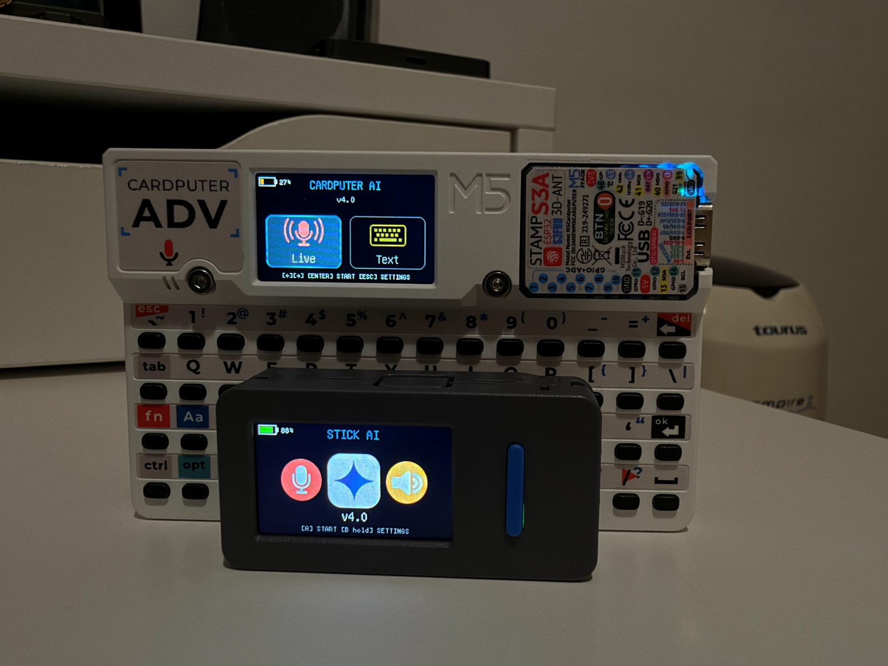
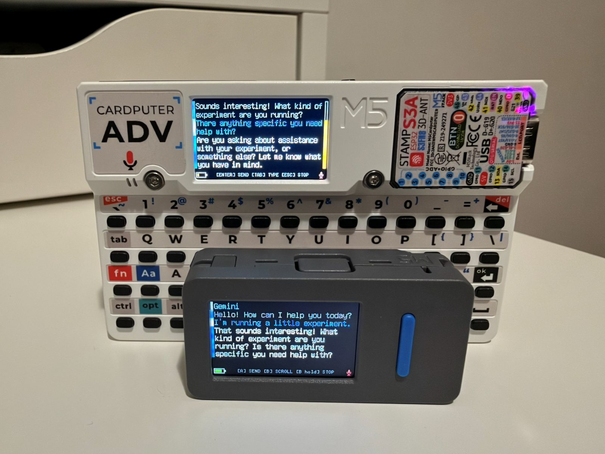
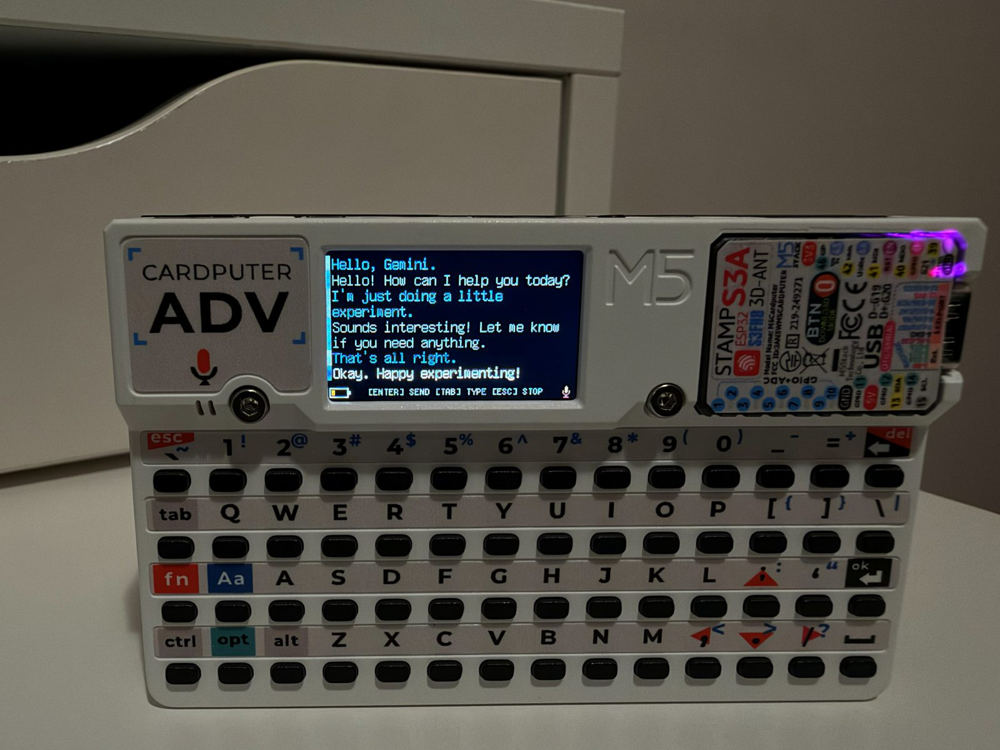
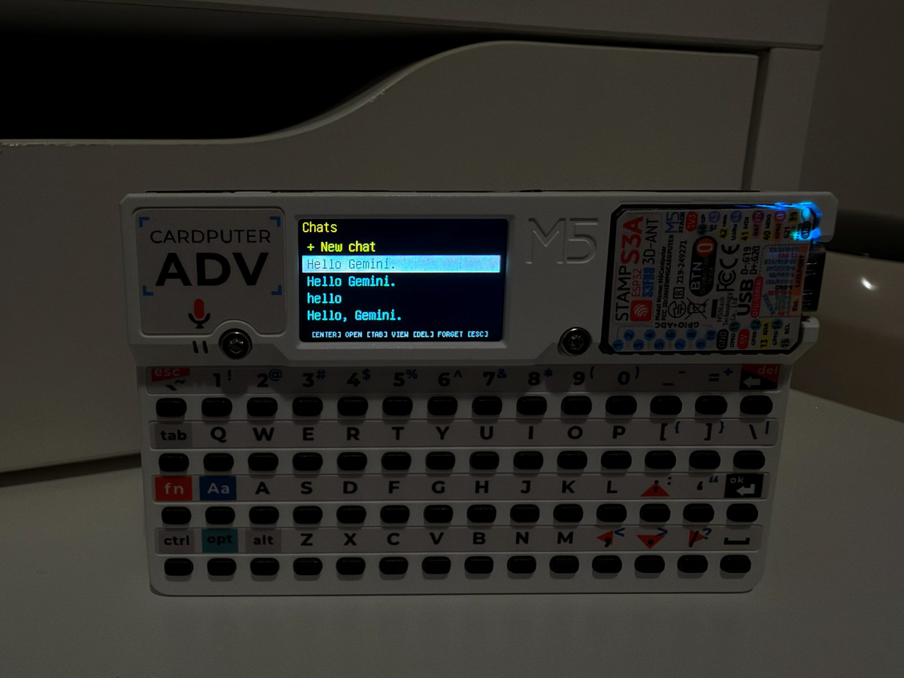
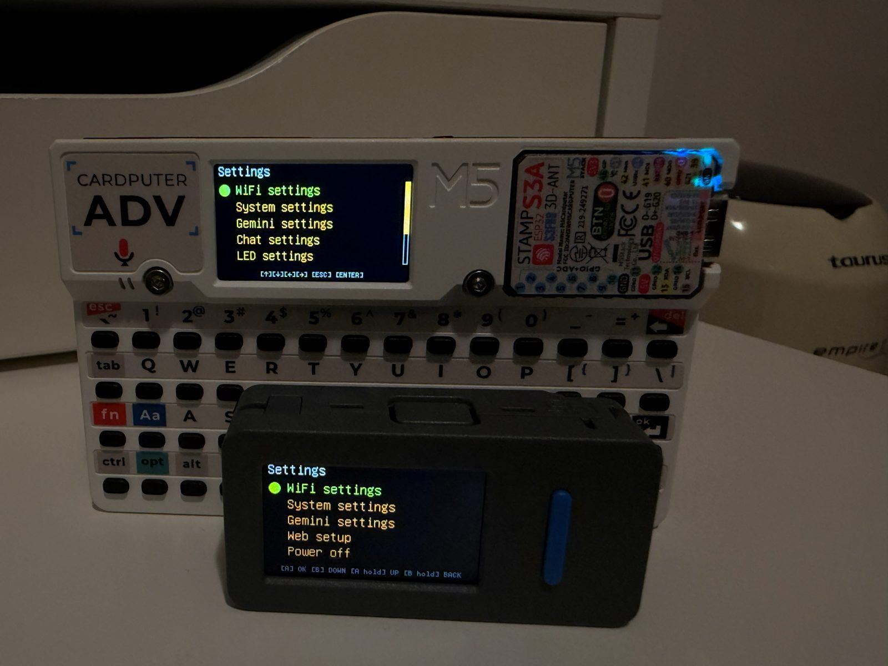
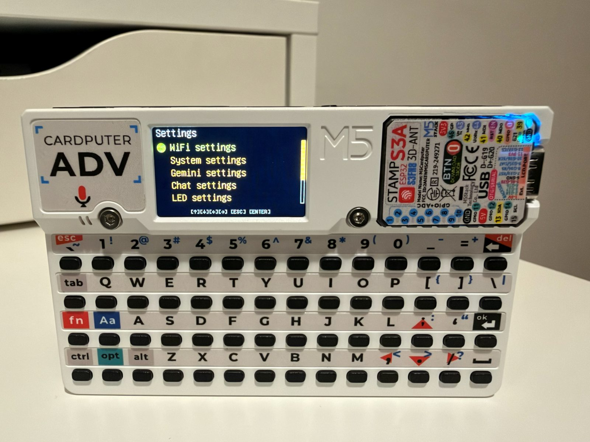
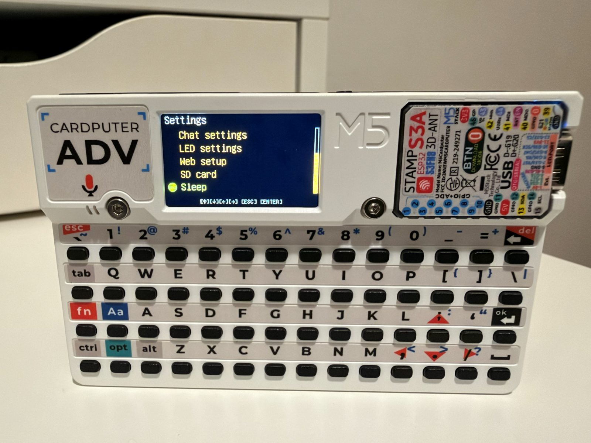

# CARDSTICK AI

CARDSTICK AI is a voice and text assistant for the M5Stack Cardputer and the M5StickS3. It talks to Google's Gemini Live API over a single WebSocket connection: you speak, Gemini answers through the speaker, and the conversation is written on the screen as it goes. On the Cardputer you can also type, and chats are saved to the SD card so they can be continued later.

On the device it is called **CARDPUTER AI** on the Cardputer and **STICK AI** on the StickS3.



It started as a fork of [M5Gemini](https://github.com/d4rkmen/M5Gemini) by d4rkmen and grew into its own project. See [Credits](#credits).

## Features

Both devices

- Real-time voice conversation with the Gemini Live API (speech to speech), with the text of both sides shown on screen.
- Half-duplex audio: the microphone and the speaker alternate, and Gemini's own voice activity detection ends your turn.
- Long sessions: when Google ends a connection after about ten minutes, the current reply is finished first and the session then resumes with its context.
- Web setup: edit WiFi networks, the API key and every other setting from a phone or PC browser.
- Up to 8 saved WiFi networks; the strongest one in range is used.
- Battery indicator, and a sleep or power-off timer for when the device is left alone.
- Configurable model, voice, volume and system instructions.

Cardputer only

- Typed chat: choose `Live` or `Text` on the start screen and switch with `TAB` inside a chat.
- Chat memory: each chat is saved to the SD card and can be reopened, continued, read, edited or deleted.
- RGB status LED with a colour, effect and speed per state.
- Settings export and import on the SD card.
- Deep sleep, woken with `G0`.

StickS3 only

- Two-button navigation.
- Power off through the power chip.

## Screens

| | |
|---|---|
|  |  |
| A voice chat on both devices | The chat screen on the Cardputer |
|  |  |
| Saved chats on the Cardputer: open, view or forget | The settings menu on both devices |
|  |  |
| Cardputer settings | Web setup, SD card and Sleep |

## Hardware

| Device | Status |
|---|---|
| M5Stack Cardputer ADV | Tested |
| M5StickS3 | Tested |
| M5Stack Cardputer (original) | Builds from the same image, not tested |

You also need a 2.4 GHz WiFi connection and a Google AI API key from <https://aistudio.google.com/apikey>.

## Install

Download the image for your device from the [releases page](https://github.com/AndryTheBeast/CARDSTICK-AI/releases):

| File | Device |
|---|---|
| `CARDPUTER_AI.bin` | Cardputer and Cardputer ADV |
| `STICK_AI.bin` | M5StickS3 |

Both are full images. Install them through M5Launcher, or flash them at offset `0x0`:

```bash
esptool --chip esp32s3 -p [Your-Serial-Port] write_flash 0x0 CARDPUTER_AI.bin
```

A full flash resets the saved settings.

## Setup

The assistant needs a WiFi network and a Gemini API key.

- **Web setup** (both devices): `Settings` → `Web setup`. With no WiFi yet, the device starts its own access point with a one-off password and shows a QR code to join it; a second QR code opens the page (`http://192.168.4.1/`). When already connected, the page is served on the current network at the address shown on screen. It has no password and is only reachable while the Web setup screen is open.
- **On the device** (Cardputer): press `ESC` on the start screen for the settings menu, move with the arrow keys and `ENTER`.
- **From a file** (Cardputer): put a `settings.txt` in the `M5Gemini` folder of the SD card and choose `Settings` → `SD card` → `Import`. `Export` writes the current settings to the same file.

```ini
wifi-enabled=true
wifi-ssid=YOUR_WIFI_SSID
wifi-pass=YOUR_WIFI_PASS
gemini-api_key=YOUR_GEMINI_API_KEY
gemini-model=gemini-3.1-flash-live-preview
gemini-voice=Kore
```

Settings are stored in NVS and survive an update that only replaces the application.

## Using it

### Cardputer

- Start screen: the arrow keys choose `Live` (voice) or `Text` (typing), `ENTER` starts, `ESC` opens the settings.
- With chat memory on, starting shows the saved chats: open one, start a new one, `DEL` forgets one, `TAB` opens it in the viewer.
- In a chat:
  - `ENTER`: send what you said so far, or skip the reply being spoken
  - `TAB`: switch between voice and typing
  - Arrow keys: scroll
  - `ESC`: stop and go back
- In typing mode the microphone is off, `ENTER` opens a box to type a message, and the reply is shown as text without being spoken. The session is still an audio session, because the Live models only answer in audio: the replies you do not hear are generated and billed as audio.
- Chat viewer: `ENTER` on a message offers Edit, Delete and Delete from here on.
- `Settings` → `Sleep`: sleep now, or set `Auto sleep`. `G0` wakes the Cardputer; it restarts.

### StickS3

`A` is the front button, `B` is the side button.

| Press | Action |
|---|---|
| `A` | OK / start a session / send or skip |
| `B` | Move down / scroll |
| Hold `A` | Move up |
| Hold `B` | Back / open settings / stop the session |

- There is no keyboard: text settings are entered in Web setup. Numbers are picked from a list of steps on the device; exact values can be entered in Web setup.
- `Settings` → `Power off`: power off now, or set `Auto power off`.
- There is no SD card, so no chat memory and no settings import or export.

## Build from source

Requires ESP-IDF v5.5.

```bash
git clone https://github.com/AndryTheBeast/CARDSTICK-AI.git
cd CARDSTICK-AI
```

Each board has its own configuration file and build directory:

```bash
# Cardputer
idf.py -B build_cardputer -D SDKCONFIG=sdkconfig build
idf.py -B build_cardputer -D SDKCONFIG=sdkconfig -p [Your-Serial-Port] flash

# StickS3
idf.py -B build -D SDKCONFIG=sdkconfig.sticks3 build
idf.py -B build -D SDKCONFIG=sdkconfig.sticks3 -p [Your-Serial-Port] flash
```

Use `app-flash` instead of `flash` for later updates: `flash` also rewrites the settings partition and clears the saved WiFi networks and API key.

These commands write the project's own partition layout. On a device that runs M5Launcher, install the release image through the Launcher instead, or the Launcher is overwritten.

If the StickS3 was put into download mode by hand (long press on the side button), single-click the side button after flashing to start the firmware.

## Credits

- **d4rkmen** wrote [M5Gemini](https://github.com/d4rkmen/M5Gemini), the Cardputer assistant this project is built on. The application structure, the hardware layer, the settings system and the first Gemini Live client are his work.
- **AndryTheBeast** directed and tested everything added since: the StickS3 port, Web setup, typed chat, chat memory, the LED effects, the power features and the audio and connection fixes.
- **Claude** (Anthropic) wrote that code with him, working from his testing on the real devices.

Libraries and services: Google Gemini Live API, ESP-IDF, LovyanGFX, mjson.

## License

GNU General Public License. M5Gemini is published under the GNU General Public License without naming a version; this project is distributed under version 3, see [LICENSE](LICENSE).
